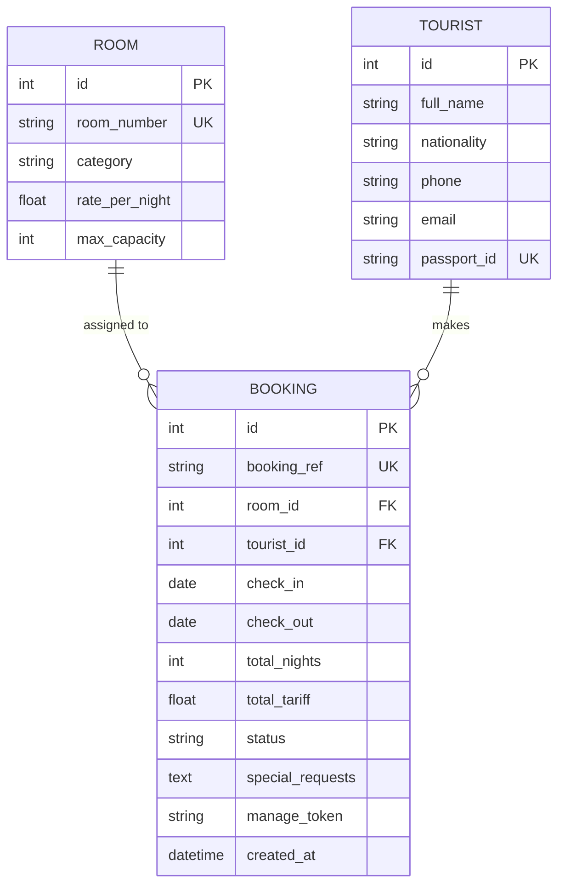
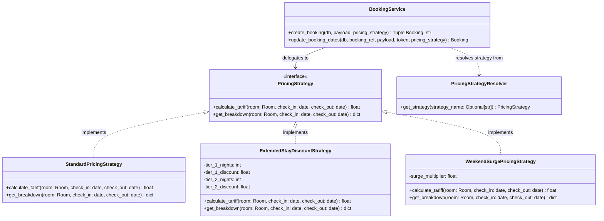

# Tourstay Portal — Web-Based Hotel Reservation System for Tourists

A modular, production-grade hotel reservation web application built for the **SE2030 (Software Engineering)** academic evaluation.

Tourstay Portal enables tourists to browse real-time room availability, book stays with instant tariff calculation, generate official printable receipt itineraries, and securely modify or cancel their reservations with atomic concurrency collision prevention.

---

## 1. System Architecture & Tech Stack

The application follows a **Layered Clean Architecture** on the backend and a modern component-driven SPA on the frontend:

```
backend/
├── app/
│   ├── routers/       # HTTP controllers (endpoints, request parsing, HTTP responses)
│   ├── services/      # Business logic (concurrency locking, collision checks, tariff calculation)
│   │   ├── booking_service.py
│   │   └── pricing_strategies.py # Strategy Pattern: tariff & pricing algorithms
│   ├── repositories/  # Database access layer (SQLAlchemy 2.0 queries)
│   ├── models.py      # SQLAlchemy 2.0 ORM entities (Room, Tourist, Booking)
│   ├── schemas.py     # Pydantic v2 validation models & request/response schemas
│   ├── database.py    # Engine, sessionmaker, SQLite pragmas, and schema initialization
│   └── main.py        # FastAPI initialization, CORS middleware, health endpoints
├── alembic/           # Alembic migrations (Postgres production path)
├── tests/             # Pytest automated test suite (17 tests)
├── seed.py            # Sample room inventory seeder
└── requirements.txt
```

### Technology Highlights
- **Backend**: Python 3.10+, FastAPI, Uvicorn, SQLAlchemy 2.0 (fully synchronous `Session`), Pydantic v2 schemas.
- **Database**:
  - **SQLite** (`tourstay.db`): Zero-setup development default with `PRAGMA foreign_keys = ON;`.
  - **PostgreSQL**: Production-ready path via `psycopg2-binary` and Alembic migrations.
- **Frontend**: React 18, Vite, TypeScript, Tailwind CSS, Lucide icons, Axios.

---

## 2. Entity-Relationship Diagram (ERD)



### Cascade & Ownership Rules
- **Shared Tourist Entity**: Tourists are identified by their unique `passport_id`. Repeat bookings by the same guest reuse their existing `tourist_id` rather than duplicating guest rows.
- **Booking Deletion**: Deleting a booking is a **hard delete** (`session.delete(booking)`), immediately releasing the room dates for other guests. Deleting a booking cascades only to booking-owned child records, **never** to `Room` or `Tourist`.
- **Integrity Safeguards**: Deleting a `Room` or `Tourist` that has active bookings is blocked with `409 Conflict` (enforced via database `RESTRICT` foreign keys and API logic).

---

## 3. Concurrency-Safe Collision Prevention Strategy

### The Race Condition Prevented
In high-concurrency reservation scenarios, two tourists might request overlapping stay dates for the same room simultaneously. Without transactional serialization, both requests would check the database at the same instant, both observe the room as unoccupied, and both execute an `INSERT`, creating a catastrophic double-booking.

### Multi-Database Locking Strategy
The check-then-insert routine in `booking_service.py` is made strictly atomic inside a single transaction:
1. **SQLite Path**: Emits `BEGIN IMMEDIATE` on the database connection upfront. This upgrades the transaction to an exclusive database write lock, preventing any concurrent connection from starting a competing write operation until the transaction commits.
2. **PostgreSQL Path**: Emits `SELECT ... FOR UPDATE` on the targeted `Room` row, placing an exclusive row-level lock on the room that serializes all concurrent booking attempts for that specific room.
3. **Atomic Overlap Evaluation**: Once the lock is acquired, the service evaluates:
   $$\text{new\_check\_in} < \text{existing\_check\_out} \quad \text{AND} \quad \text{new\_check\_out} > \text{existing\_check\_in}$$
   against all active `CONFIRMED` bookings for that room.
4. **Self-Exclusion on Date Modification**: When modifying stay dates (`PATCH /api/v1/bookings/{booking_ref}`), the booking's own ID is excluded from the collision query, allowing extensions and shifts without falsely conflicting with itself.

---

## 4. Design Patterns: Strategy Pattern (Tariff & Pricing Calculation)

### Motivation & Open/Closed Principle (OCP)
In hotel reservation systems, tariff computation rules change dynamically according to seasons, length of stay, promotions, and weekend demand surges. Hardcoding tariff calculation as a monolithic arithmetic formula inside the reservation service violates the **Single Responsibility Principle (SRP)** and the **Open/Closed Principle (OCP)**.

To decouple pricing algorithms from database concurrency and booking lifecycle orchestration, Tourstay Portal implements the **GoF Strategy Pattern** (Behavioral):
- **Strategy Interface (`PricingStrategy`)**: Declares the contract `calculate_tariff(room, check_in, check_out) -> float` and `get_breakdown(room, check_in, check_out) -> dict`.
- **Concrete Strategies**: Encapsulate independent, swappable pricing algorithms:
  - `StandardPricingStrategy`: Flat nightly calculation ($\text{nights} \times \text{rate\_per\_night}$). Default for standard stays.
  - `ExtendedStayDiscountStrategy`: Tiered volume discount (10% off for 5–9 nights; 15% off for 10+ nights) to encourage extended tourist stays.
  - `WeekendSurgePricingStrategy`: Dynamic peak pricing applying a 20% surcharge on Friday and Saturday nights while charging weekdays at base rate.
- **Context (`BookingService`)**: Delegates tariff computation to the active `PricingStrategy` instance during booking creation and date modification.
- **Strategy Factory/Resolver (`PricingStrategyResolver`)**: Selects the target strategy by key name with fallback to `StandardPricingStrategy`.

### Strategy Pattern Class Diagram



### Strategy Comparison Matrix

| Strategy | Formula / Business Rule | Use Case |
|---|---|---|
| **`StandardPricingStrategy`** *(Default)* | $\text{nights} \times \text{rate\_per\_night}$ | Standard tourist reservations with flat nightly pricing. |
| **`ExtendedStayDiscountStrategy`** | Stays $\ge 5$ nights: **10% off**<br>Stays $\ge 10$ nights: **15% off** | Volume discount encouraging longer tourist stays. |
| **`WeekendSurgePricingStrategy`** | Friday & Saturday nights: **+20% surge**<br>Sunday–Thursday: base rate | Dynamic weekend pricing capturing peak tourist demand. |

### API Strategy Selection
Clients can explicitly select a pricing policy via the optional `pricing_strategy` query parameter:
- `POST /api/v1/bookings?pricing_strategy=extended_stay`
- `PATCH /api/v1/bookings/{booking_ref}?pricing_strategy=weekend_surge`
- `GET /api/v1/bookings/pricing/strategies` — Returns metadata for all registered strategies.

---

## 5. SQLite vs. PostgreSQL Split

To provide zero-setup simplicity for development alongside enterprise PostgreSQL readiness:

- **SQLite Development Mode (Default)**:
  - Connects to `sqlite:///./tourstay.db`.
  - Tables are created automatically on FastAPI startup via `Base.metadata.create_all()` in `database.py`.
  - Foreign key constraints are enforced on every connection via `PRAGMA foreign_keys = ON;`.
- **PostgreSQL Production Mode**:
  - Activated when `DATABASE_URL=postgresql://...` is set.
  - Managed exclusively through Alembic:
    ```bash
    alembic upgrade head
    ```
> [!NOTE]
> The SQLite dev path (`Base.metadata.create_all()`) and the PostgreSQL migration path (`alembic upgrade head`) are designed to be mutually exclusive and should not be used to manage the same physical schema simultaneously.

---

## 6. Security & Management Token

For this academic scope:
- At booking creation time, a cryptographically secure random token (`manage_token`) is generated.
- The token is returned once in the `201 Created` payload.
- The frontend saves this token in `localStorage` under `tourstay_token_{booking_ref}` for seamless modification or cancellation on the booking device.
- Any subsequent `PATCH /api/v1/bookings/{ref}` or `DELETE /api/v1/bookings/{ref}` requires the token supplied via the `X-Manage-Token` HTTP header or `manage_token` query parameter. Requests with missing or invalid tokens are rejected with `401 Unauthorized` or `403 Forbidden`.

---

## 7. Getting Started & Run Commands

### Prerequisites
- Python 3.10+
- Node.js 18+ and npm

### Backend Setup

1. Open a terminal and navigate to `backend/`:
   ```bash
   cd backend
   ```

2. Create and activate a Python virtual environment:
   ```bash
   python3 -m venv venv
   source venv/bin/activate    # On Windows: venv\Scripts\activate
   ```

3. Install dependencies:
   ```bash
   pip install -r requirements.txt
   ```

4. Seed the database with sample rooms:
   ```bash
   python seed.py
   ```

5. Start the FastAPI development server:
   ```bash
   uvicorn app.main:app --reload --port 8000
   ```
   The backend API will be live at `http://localhost:8000`. Interactive OpenAPI documentation is available at `http://localhost:8000/docs`.

---

### Frontend Setup

1. Open a second terminal and navigate to `frontend/`:
   ```bash
   cd frontend
   ```

2. Install dependencies:
   ```bash
   npm install
   ```

3. Launch the Vite development server:
   ```bash
   npm run dev
   ```
   The web application will be accessible at `http://localhost:5173`.

---

## 8. Automated Testing (Pytest Suite — 17 Tests)

The automated test suite in `backend/tests/` uses an isolated in-memory SQLite database to test all core features, validations, edge cases, and design pattern implementations:

Run the test suite from `backend/`:
```bash
cd backend
source venv/bin/activate
pytest -v
```

### Verified Test Cases:

#### Booking Lifecycle & Concurrency (`tests/test_bookings.py`):
1. `test_date_validation_rejected` — Rejects same-day or inverted date ranges (`check_out <= check_in`) with HTTP 422.
2. `test_booking_creation_success` — Verifies successful reservation, dynamic tariff calculation, generated `TRV-{year}-{code}`, and `manage_token`.
3. `test_booking_overlap_collision_rejected` — Verifies rejection (HTTP 409 Conflict) for encompassing, starting-within, or ending-within overlapping reservations.
4. `test_adjacent_booking_allowed` — Verifies back-to-back stays where checkout of stay 1 equals check-in of stay 2 succeed.
5. `test_update_booking_dates_success_and_exclude_self` — Verifies modifying dates on an existing booking without colliding with itself.
6. `test_update_booking_dates_collision_with_other_rejected` — Verifies modifying stay dates into another room booking's dates is rejected with HTTP 409.
7. `test_delete_booking_frees_room` — Verifies hard delete immediately frees the room for the same dates.
8. `test_manage_token_security_enforcement` — Verifies 401 / 403 responses when attempting PATCH or DELETE without a valid token.
9. `test_shared_tourist_reused_no_duplicate` — Verifies repeat bookings with the same passport number reuse the existing `Tourist` record.
10. `test_reference_collision_retry` — Verifies collision retry loop behavior during booking reference generation.

#### Strategy Pattern Suite (`tests/test_pricing_strategies.py`):
11. `test_standard_pricing_strategy` — Verifies flat nightly tariff computation.
12. `test_extended_stay_discount_strategy` — Verifies 10% discount for $\ge 5$ nights and 15% discount for $\ge 10$ nights.
13. `test_weekend_surge_pricing_strategy` — Verifies 20% surge rate applied exclusively to Friday and Saturday nights.
14. `test_pricing_strategy_resolver` — Verifies resolver returns requested strategies and safely defaults to Standard for unknown inputs.
15. `test_booking_service_strategy_injection` — Verifies `BookingService.create_booking` delegates to an injected custom strategy.
16. `test_api_pricing_strategies_endpoint` — Verifies `GET /api/v1/bookings/pricing/strategies` lists all registered strategy metadata.
17. `test_api_create_booking_with_strategy_param` — Verifies `POST /api/v1/bookings?pricing_strategy=extended_stay` computes the discounted tariff through HTTP.

---

## 9. API Reference Summary

| Method | Endpoint | Description | Auth / Security |
|---|---|---|---|
| `GET` | `/health` | Service health check | Public |
| `GET` | `/api/v1/rooms` | List all hotel rooms | Public |
| `GET` | `/api/v1/rooms/available` | List rooms available between `check_in` and `check_out` | Public |
| `GET` | `/api/v1/bookings/pricing/strategies` | List registered pricing strategies (Strategy Pattern) | Public |
| `POST` | `/api/v1/bookings` | Create a booking (`?pricing_strategy=standard\|extended_stay\|weekend_surge`) | Public (returns `manage_token`) |
| `GET` | `/api/v1/bookings/{booking_ref}` | Fetch full itinerary & printable receipt data | Public |
| `GET` | `/api/v1/bookings` | Paginated bookings list with status filter | Public |
| `PATCH` | `/api/v1/bookings/{booking_ref}` | Modify stay dates (`?pricing_strategy=...`) | Requires `X-Manage-Token` |
| `DELETE` | `/api/v1/bookings/{booking_ref}` | Hard-delete booking and release room | Requires `X-Manage-Token` |

---

## 10. Definition of Done Checklist

- [x] Backend boots cleanly against SQLite fallback with zero setup beyond `pip install` and `seed.py`.
- [x] Full Clean Architecture separation (`routers/` → `services/` → `repositories/` → `models/` + `schemas/`).
- [x] Fully synchronous SQLAlchemy 2.0 throughout without async driver conflicts.
- [x] Atomic concurrency collision protection (`BEGIN IMMEDIATE` on SQLite, `FOR UPDATE` on Postgres).
- [x] Shared, reusable `Tourist` entity deduplicated by `passport_id`.
- [x] Pydantic v2 strict date range and guest credential validation.
- [x] **GoF Strategy Pattern** implemented for interchangeable tariff & pricing algorithms (`Standard`, `ExtendedStayDiscount`, `WeekendSurge`).
- [x] Secret `manage_token` authorization for booking modifications and cancellations.
- [x] 100% passing Pytest automated test suite (17 passed across booking lifecycle, collision prevention, and pricing strategies).
- [x] React 18 + TypeScript + Vite + Tailwind CSS responsive frontend with Room Catalog, Booking Intake Modal, Management Dashboard, and `@media print` Receipt Card.
- [x] Complete documentation, ERD & Strategy Pattern Mermaid diagrams, and `.gitignore`.
